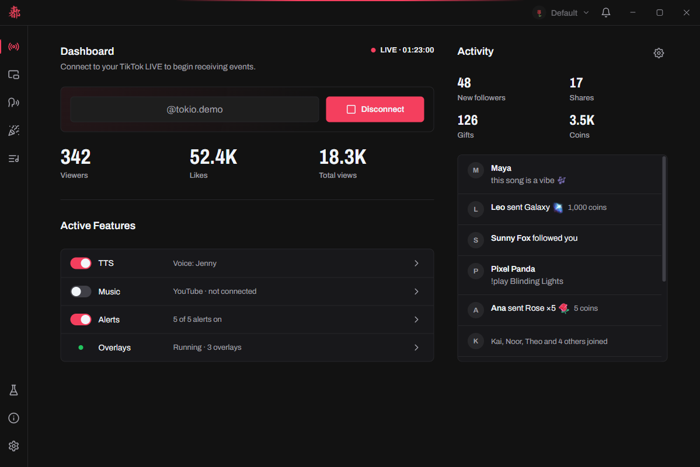
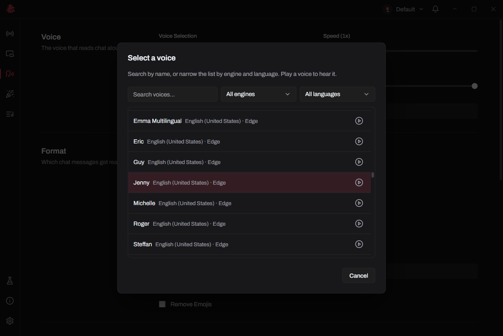
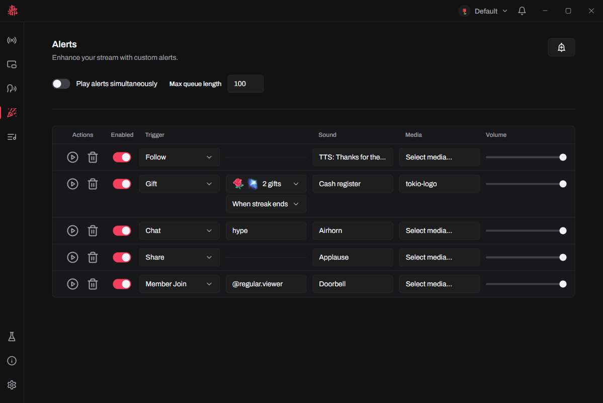
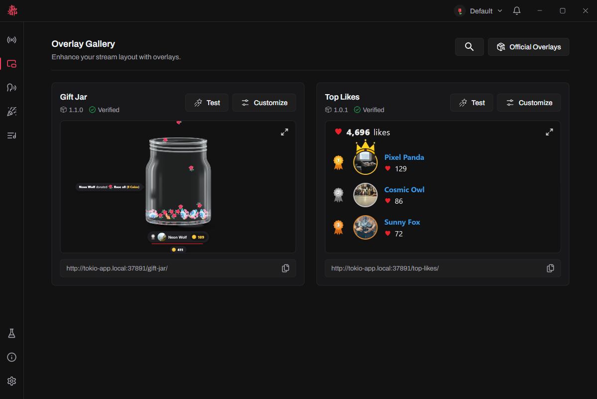
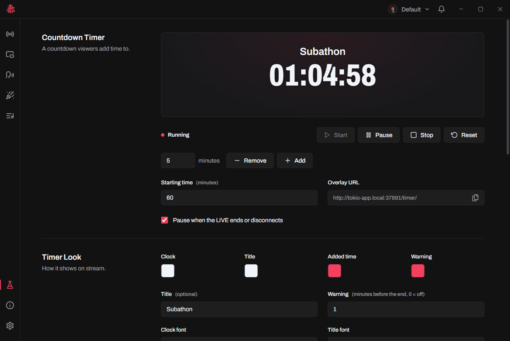

<div align="center">
  
  <h1>Tokio</h1>
  <p>Make your TikTok LIVE react to chat, gifts, likes and more: text-to-speech, music requests, alerts, a countdown timer and overlays.</p>
  <p>
    <a href="https://tokio.ialfaro.com/download/">Download</a> ·
    <a href="https://tokio.ialfaro.com">Website</a> ·
    <a href="https://github.com/tokio-app/tokio/issues">Report a bug</a>
  </p>
</div>



Tokio is a desktop app for Windows, macOS and Linux that connects to your TikTok LIVE and reacts to what happens in it. Its overlays work in **OBS**, **TikTok LIVE Studio** and any streaming app that can show a web page.

## Features

<table>
  <tr>
    <td width="50%" valign="top">
      
      <p><a href="https://tokio.ialfaro.com/docs/features/text-to-speech/"><b>Text-to-speech</b></a>: chat read aloud with TikTok, Edge or Windows voices.</p>
    </td>
    <td width="50%" valign="top">
      
      <p><a href="https://tokio.ialfaro.com/docs/features/alerts/"><b>Alerts</b></a>: sounds, spoken messages, images and videos for follows, gifts, likes and more.</p>
    </td>
  </tr>
  <tr>
    <td width="50%" valign="top">
      
      <p><a href="https://tokio.ialfaro.com/docs/features/overlays/"><b>Overlays</b></a>: install the official ones or import your own, and set them up from the gallery.</p>
    </td>
    <td width="50%" valign="top">
      
      <p><a href="https://tokio.ialfaro.com/docs/features/countdown-timer/"><b>Countdown timer</b></a>: a subathon clock that gifts, likes, follows and chat add time to.</p>
    </td>
  </tr>
</table>

Viewers can also [request songs](https://tokio.ialfaro.com/docs/features/music-requests/) from chat on YouTube Music or Spotify, and [profiles](https://tokio.ialfaro.com/docs/features/profiles-and-settings/) keep separate settings for different streams.

## Getting started

1. [Download Tokio](https://tokio.ialfaro.com/download/) for Windows, macOS or Linux. The [install guide](https://tokio.ialfaro.com/docs/install/) covers the warnings shown the first time it opens.
2. Get a free API key from [Euler Stream](https://www.eulerstream.com/register) and paste it in **Settings → TikTok LIVE**.
3. Start your LIVE, enter your `@username` on the **Home** page and connect.

The [docs](https://tokio.ialfaro.com/docs/) cover every feature and how to [add an overlay](https://tokio.ialfaro.com/docs/guides/adding-an-overlay/) to your streaming app.

## Building from source

Requires Node.js 24+ and Yarn 1.

```sh
yarn install
yarn dev          # run in development (quit Tokio first)
yarn test         # unit tests
yarn typecheck    # type-check every process
yarn lint         # lint
yarn build:win    # build the Windows setup into dist/
yarn build:mac    # build the macOS zips into dist/ (on macOS)
yarn build:linux  # build the Linux AppImage into dist/
```

Want to help? Read [CONTRIBUTING.md](CONTRIBUTING.md) and the [code of conduct](CODE_OF_CONDUCT.md).

## License

Tokio's source code is licensed under the [MIT License](LICENSE). One file is an exception: `src/main/services/tts/providers/edge/common/drm-v2.ts` is derived from [edge-tts](https://github.com/rany2/edge-tts) and is licensed under the [GNU LGPL v3.0](LICENSES/LGPL-3.0.txt), which builds on the [GNU GPL v3.0](LICENSES/GPL-3.0.txt).

Tokio connects to TikTok LIVE through [@tokioapp/connector](https://github.com/tokio-app/connector), which is also MIT-licensed.

See [THIRD_PARTY_NOTICES.md](THIRD_PARTY_NOTICES.md) for details. The **About** page in the app shows the same notices.

Tokio is not affiliated with or endorsed by TikTok or ByteDance.
